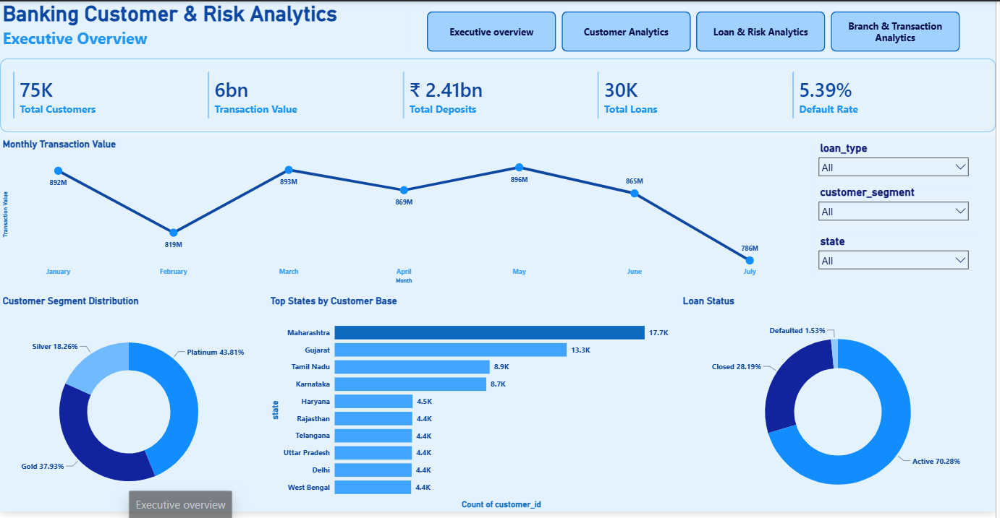
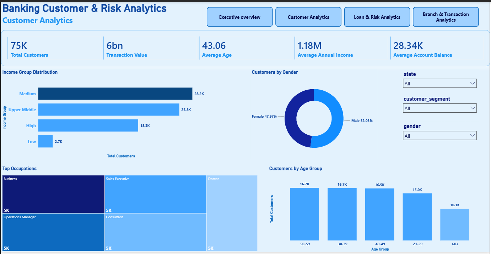
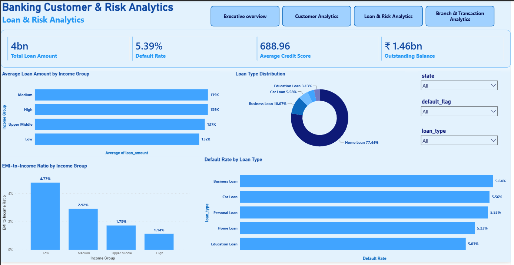
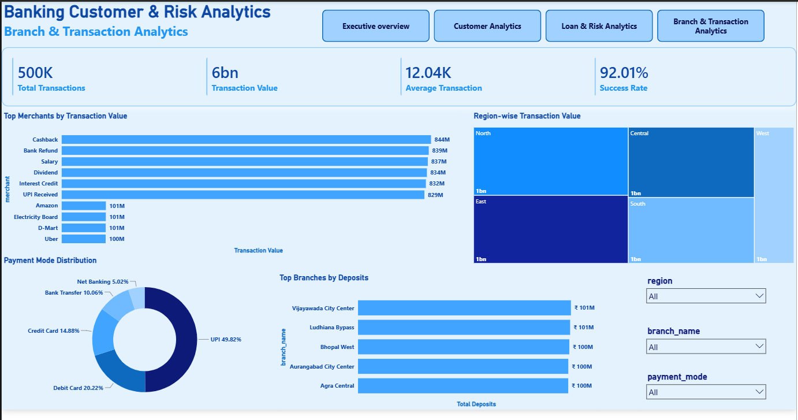

# 🏦 Banking Customer & Risk Analytics

An end-to-end data analytics project using **Python, MySQL, Power BI, and Machine Learning** to analyze banking customers, accounts, loans, transactions, and credit risk. The project transforms raw data into actionable business insights through data cleaning, SQL analysis, interactive dashboards, and exploratory loan-default prediction.

## 🎯 Project Objectives

- Analyze customer demographics, income, and account balances.
- Identify loan-default patterns and potential credit-risk indicators.
- Evaluate branch performance and transaction trends.
- Build interactive Power BI dashboards for business users.
- Develop machine-learning models to explore loan-default prediction.

## 🛠️ Tech Stack

| Area | Technologies |
|---|---|
| Data Cleaning & EDA | Python, Pandas, NumPy, Matplotlib |
| Database & Analysis | MySQL, SQL |
| Visualization | Power BI, DAX |
| Machine Learning | Scikit-learn, Logistic Regression, Random Forest |
| Tools | VS Code, Jupyter Notebook, MySQL Workbench, Git, GitHub |

## 📊 Dataset Overview

The full working dataset contains approximately **690,100 records** across five datasets.

| Dataset | Records | Description |
|---|---:|---|
| Customers | 75,000 | Demographics, income, occupation, and segments |
| Accounts | 85,000 | Account types and balances |
| Loans | 30,000 | Loan amounts, interest rates, EMI, and default-related fields |
| Transactions | 500,000 | Transaction amounts, dates, payment methods, and statuses |
| Branches | 100 | Branch locations, regions, and related information |

*Note: Only sample data is uploaded to GitHub because the full working dataset is large.*

## ⚙️ Project Workflow

```text
Banking CSV Datasets
        ↓
Python: Cleaning, Validation & EDA
        ↓
MySQL: 35+ Business SQL Questions
        ↓
Power BI: Interactive Dashboards
        ↓
Machine Learning: Default Prediction
```

### 1. Data Cleaning and Analysis
Used Python to inspect datasets, handle data-quality issues, validate relationships, and prepare analytical features such as age groups, income groups, and credit-score categories.

### 2. SQL Business Analysis
Used MySQL queries, JOINs, aggregations, CTEs, and other SQL techniques to investigate customer segments, loan performance, transaction behavior, and branch activity.

### 3. Power BI Dashboard
Created a four-page interactive dashboard for different business audiences.

## 📈 Power BI Dashboard

The dashboard includes four analytical pages:

- **Executive Overview:** Key performance indicators, customer segments, loan status, and transaction trends.
- **Customer Analytics:** Customer demographics, occupations, income groups, and segments.
- **Loan & Risk Analytics:** Loan distribution, credit scores, EMI-to-income ratio, and default patterns.
- **Branch & Transaction Analytics:** Branch comparisons, payment methods, transaction values, and deposit-related measures.

### Dashboard Screenshots

**1. Executive Overview**

Add your screenshot here by uploading it to the `images/` folder.



**2. Customer Analytics**



**3. Loan & Risk Analytics**



**4. Branch & Transaction Analytics**




## 🔍 Key Business Insights

- The `default_flag` field has a positive-label rate of **5.39%**.
- The Poor credit-score category has a reported default rate of **21.68%**.
- UPI accounts for approximately **49.8%** of transactions.
- Platinum customers represent approximately **43.8%** of the customer base.
- Transaction and branch analysis helps identify areas for operational investigation.

These findings describe the current dataset and should be validated before being used for real banking decisions.

## 🤖 Machine Learning: Loan-Default Prediction

Built and compared two classification models using loan and customer features, including credit score, loan amount, interest rate, EMI, annual income, age, and occupation.

| Metric | Logistic Regression | Random Forest |
|---|---:|---:|
| Precision | 12.12% | 20.56% |
| Recall | 72.45% | 6.81% |
| F1-score | 20.76% | 10.23% |
| ROC-AUC | 0.7777 | 0.7648 |

**Key finding:** Logistic Regression detected more positive default labels, while Random Forest had higher precision at the tested threshold. Threshold analysis also demonstrated the trade-off between missed defaults and false-positive alerts.

These are exploratory results. Further validation, threshold tuning on validation data, and data-quality checks are needed before considering practical use.

## 💼 Business Recommendations

- Investigate credit-score and affordability indicators when assessing loan risk.
- Monitor transaction failures and payment-channel performance.
- Compare branch workloads and deposit measures to identify operational improvement opportunities.
- Use customer segmentation to investigate suitable products and relationship strategies.
- Standardize default definitions and monetary units to improve reporting reliability.

## ⚠️ Limitations

- The repository contains sample data rather than the complete working dataset.
- `default_flag` contains 1,617 positive labels, while `loan_status` contains 452 loans marked `Defaulted`; these definitions need reconciliation.
- Currency units and some reported portfolio metrics require verification.
- The ML models have not been validated on external or future data and are not production-ready.

## 📁 Repository Structure

```text
Banking-Customer-Risk-Analytics/
├── sample_data/       # Sample datasets
├── notebooks/         # Python cleaning and EDA
├── sql/               # SQL business queries
├── powerBI/           # Power BI report (.pbix)
├── images/            # Dashboard screenshots
├── ml/                # ML notebooks or scripts
├── reports/           # Business report and ML results
├── requirements.txt   # Python dependencies
└── README.md
```

*Adjust folder names to match your actual repository.*

## 🚀 How to Run

1. Clone the repository.
2. Install the dependencies using `pip install -r requirements.txt`.
3. Run the available Python notebooks or scripts to inspect and prepare the sample data.
4. Configure MySQL, load the prepared datasets, and execute the SQL scripts.
5. Open the `.pbix` file in Power BI Desktop and configure the data source.
6. Run the ML notebook or script using the required input data and review its evaluation results.

## 🔮 Future Improvements

- Improve ML validation and credit-risk evaluation.
- Automate data-quality checks.
- Explore cloud integration and scheduled data refresh.
- Develop additional predictive analytics after defining suitable business targets.

## 👩‍💻 Author

**Gayatri Kasbekar**

- **GitHub:** [Gayatrik04](https://github.com/Gayatrik04)
- **LinkedIn:** [Gayatri Kasbekar](https://www.linkedin.com/in/gayatri-kasbekar-674a883a3/)
- **Email:** gayatrikasbekar1311@gmail.com